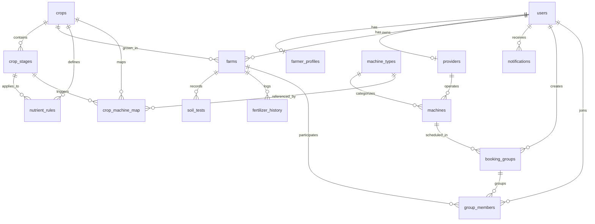
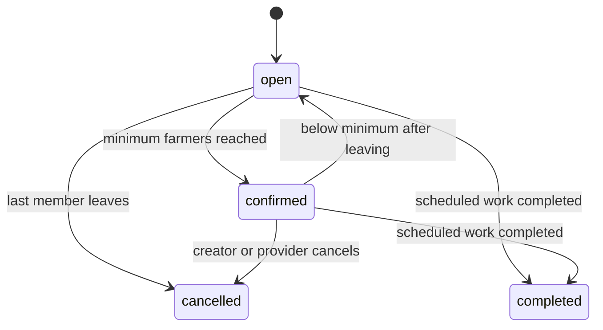

# AgriSync Documentation

**AgriSync** is an AI-powered multilingual crop advisory and community machinery-sharing platform designed specifically for small and marginal farmers in India.

---

## 🏗 System Architecture & Technology Stack

- **Backend**: Python 3.11, FastAPI, SQLAlchemy 2.0, Alembic, Pydantic v2
- **Database**: PostgreSQL 16 + PostGIS (Geospatial storage & spatial queries)
- **Cache & Pub/Sub**: Redis 7
- **Frontend**: React 18 + Vite (JavaScript / JSX), Tailwind CSS, Mobile-First PWA (`vite-plugin-pwa`)
- **Realtime**: Native browser WebSocket via `useWebSocket` hook
- **Voice**: Web Speech API with fallback to text input
- **ML**: scikit-learn / XGBoost

---

## 🗄 Database Schema & Entity-Relationship (ER) Diagram

AgriSync utilizes **PostgreSQL 16 with PostGIS** for spatial data storage (farmer locations, provider machines, input sellers) leveraging `GEOGRAPHY(Point, 4326)` with **GiST spatial indexes** and `ST_DWithin` spatial proximity matching.



### Key Table Overview

- `users`: Core identity table with unique phone number and role (`farmer`, `provider`, `admin`).
- `farmer_profiles`: Geocoded location (`GEOGRAPHY(Point,4326)` + GiST index), village, district, state.
- `providers`: Machine owners, FPOs, and Custom Hiring Centers (CHCs).
- `crops` & `crop_stages`: Agronomic crop lifecycle catalog with multilingual names (English, Hindi, Marathi).
- `nutrient_rules`: Rule-based agronomic recommendations with mandatory `source="SAMPLE - verify with ICAR / state agriculture dept"`.
- `farms`: Individual land parcels owned by farmers with crop stage, area, soil type, and irrigation details.
- `soil_tests`: Soil pH, Nitrogen, Phosphorus, Potassium, Organic Carbon measurements (`ph CHECK 0..14`).
- `machines`: Provider machinery listing with location (`GEOGRAPHY(Point,4326)` + GiST index), rate per acre, and rating.
- `booking_groups`: Community machinery sharing pool with minimum farmer count & maximum acre capacity.
- `group_members`: Individual farmer join entries with strict `UNIQUE(group_id, farmer_id)` constraint.
- `input_sellers`: Geocoded agricultural stores (`GEOGRAPHY(Point,4326)`) offering seeds, fertilizers, pesticides.

---

## 📜 Principles & Rules

1. **Rule-Based & Data-Driven Agronomy Advisory**:
   All advisory logic is strictly rule-based and data-driven stored in DB/JSON with a mandatory `source` field. LLMs (if integrated for natural language phrasing) MUST NEVER invent nutrient quantities, pesticide doses, or agronomy recommendations.
2. **Seed Data Attribution**:
   All seeded agronomy values in the platform are placeholders clearly marked with:
   `source="SAMPLE - verify with ICAR / state agriculture dept"`
3. **Accessibility**:
   Mobile-first layout, large touch targets, low-bandwidth optimized assets, simple language with multilingual support (English, Hindi, Marathi).

---

## 🚀 Module Overview & Status

| Module                    | Description                                                                                       | Status      |
| ------------------------- | ------------------------------------------------------------------------------------------------- | ----------- |
| **Skeleton & Infra**      | Monorepo layout, Docker Compose (PostGIS, Redis, FastAPI, React PWA), Health Check                | ✅ Complete |
| **Database Layer**        | PostgreSQL 16 + PostGIS schema, Alembic 001, Pydantic v2 schemas, Pune seed script, spatial tests | ✅ Complete |
| **User & Onboarding**     | Farmer profile, location, land holding size, crop history, language preferences                   | ⏳ Pending  |
| **Rule Advisory Engine**  | Soil, crop stage, weather-driven input guidance with strict source tracking                       | ⏳ Pending  |
| **Machinery Sharing**     | Group booking, local resource search, cost sharing, schedule optimization                         | ⏳ Pending  |
| **Local Community & Map** | Spatial discovery of machinery, group pools, and nearby advisories                                | ⏳ Pending  |

## Auth

AgriSync uses a passwordless phone + OTP authentication flow with Redis rate limiting, SMS adapter architecture, and JWT session tokens.

### OTP Generation & Storage
- **Code Generation**: Cryptographically secure 6-digit random code (`100000`–`999999`) generated using Python's `secrets` module.
- **Redis TTL & Key Schema**:
  - `otp:{phone}`: Stores the active 6-digit OTP with a strict **5-minute TTL (300 seconds)**.
  - `otp:attempts:{phone}`: Tracks failed verification attempts. Max **5 attempts** allowed before the OTP is deleted and locked out.
  - `ratelimit:otp:{phone}`: Rate limits OTP requests to a max of **3 requests per phone per 10 minutes (600 seconds)**. Exceeding this limit returns `HTTP 429 Too Many Requests`.

### SMS Provider Adapter
SMS delivery is decoupled behind `BaseSMSProvider` (`backend/app/services/sms.py`):
- **`ConsoleSMSProvider`**: Formats and logs the OTP to stdout/logs for local development. Default when no provider API keys are configured in `.env`.
- **`TwilioSMSProvider`**: Dispatches SMS via Twilio Messages API using asynchronous HTTP (`httpx`).
- **`MSG91SMSProvider`**: Dispatches SMS via MSG91 OTP API using asynchronous HTTP (`httpx`).
- Selection is automatic based on `.env` settings (`SMS_PROVIDER`, `TWILIO_*`, `MSG91_*`).

### User Registration & Name Validation
- **New Users**: When an unregistered phone number calls `POST /api/v1/auth/verify-otp`, `name` is a **required field** validated between **2 and 60 characters**.
- **Existing Users (`PUT /api/v1/me`)**: Allows farmers to update their name and language preference. `name` is a required field validated between **2 and 60 characters**.
- **JWT & Response Payload**:
  - The user's name is embedded into the JWT token claims (`name`) for both access and refresh tokens.
  - Returned in `POST /api/v1/auth/verify-otp`, `GET /api/v1/me`, and `PUT /api/v1/me`.

### Frontend Experience
- **OTP Screen**: Displays "Your Name" text input dynamically for new phone numbers.
- **Resend OTP**: Features a 30-second cooldown timer disabling repeated requests until the cooldown expires.
- **Error Handling**: Clear error feedback for expired OTPs, incorrect codes, remaining attempt counters, or rate limits.
- **Profile / Settings**: Provides an editable personal info card to update the farmer's name.
- **Personalized Header & Dashboard**: Displays `"Namaste, {name}"` in the application header and dashboard once set.

## Advisory Engine

The advisory endpoint is `GET /api/v1/farms/{farm_id}/advisory?lang=en|hi|mr`.
It calculates the current crop stage from `sowing_date`, rates the latest soil test using
`backend/app/data/soil_thresholds.json`, and matches deterministic `nutrient_rules`.
Only the owning farmer can access a farm's advisory.

### Rule format

Store conditions as JSON with a nutrient level and stage, for example:

```json
{ "nutrient": "nitrogen", "level": ["low"], "stage": "tillering" }
```

The nutrient name must match a soil threshold field. A rule may omit the nutrient and
level for general stage guidance. Set `input_category` to the fertilizer or organic input
category used by fertilizer history so recently applied inputs can be marked for 21 days.
Every sample rule must use the source string:
`SAMPLE - verify with ICAR / state agriculture dept`.

To add a rule, add a crop stage to the seed catalog if needed, then add a `NutrientRule`
entry in `backend/app/seed.py` with the structured `condition`, plain guidance text, input
category, and source. Do not add a dose or brand unless it is explicitly verified and
intended to be part of that rule text.

## Machinery Calendar

The protected `GET /api/v1/farms/{id}/machinery-plan` endpoint turns each
`crop_machine_map` row into a date window. It adds the crop stage start day,
the mapping's `days_offset`, and `window_days` to the farm sowing date. The
plan is sorted by need start and includes status, paise-based solo/group-of-5
cost estimates, and privacy-safe nearby demand counts.

To add a machinery need, add a `CropMachineMap` entry with the crop, stage,
machine type, offset, window, and the required sample source. What-if sowing
date, crop, and area overrides are query-only and never update the farm.

## Resource Finder

The protected resource endpoints are `GET /api/v1/resources/machines`,
`/providers`, `/input-sellers`, and `/machines/{id}`. Searches use PostGIS
`GEOGRAPHY`, `ST_DWithin` for radius filtering, and `ST_Distance` for sorting
and returned `distance_km`. Coordinates are returned as `{lat, lng}` even
though PostGIS stores points as `(lng, lat)`. Searches default to verified
resources and can fall back to the authenticated farmer's saved location.

The frontend map is available at `/map`. It supports URL filters such as
`/map?type=sprayer&date=2026-10-05`, clustered resource layers, a debounced
radius slider, marker/list selection, and temporary booking destinations.

## Group Booking

Group booking uses `member share = acres * rate_per_acre + mobilization_cost * acres / total_acres`.
Solo cost is `acres * rate_per_acre + full mobilization_cost`, and savings are solo cost minus
the member share. All calculations use integer paise and largest-remainder rounding. For 2, 3,
and 5 acres at Rs 1,000 per acre with Rs 1,500 mobilization, shares are Rs 2,300, Rs 3,450,
and Rs 5,750; the 2-acre farmer saves Rs 1,200 from a Rs 3,500 solo cost.



Group membership changes lock the group row, enforce acreage and deadlines, recalculate every
share, and notify affected users. Member snapshots expose first name, village, and acres only.
